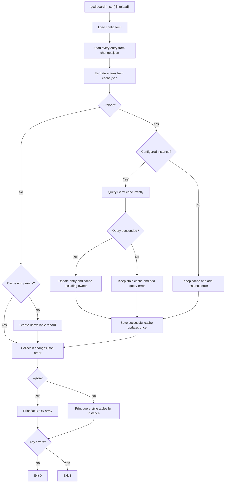

# 027 - CLI tracked changes board

## Problem

The TUI keeps a persistent set of Gerrit changes in `changes.json`, but viewing
that set currently requires starting the interactive dashboard. The existing
`query` subcommand prints compact one-shot Gerrit search results, but it does not
operate on the changes selected for tracking.

Add a cache-first `board` subcommand that prints the complete tracked set for
quick shell use and automation without making network requests by default.

## Scope

Target invocations:

```bash
gcd board
gcd -c path/to/config.toml board
gcd board --json
gcd board --reload
```

The command:

- Loads tracked entries from the configured `changes_file`.
- Includes every entry in `changes.json`, including entries marked `deleted` or
  `disabled`.
- Reads display details from `cache.json` without querying Gerrit by default.
- Queries Gerrit and updates `cache.json` only when `--reload` is specified.
- Prints compact query-style tables by default or machine-readable JSON with
  `--json`.
- Does not start the TUI, initialize plugins, or modify `changes.json`.

Filters, local status columns, and TUI layout modes are out of scope.

## CLI Surface

```text
gcd [-c/--config PATH] board [--json] [--reload]
```

`board` is a sibling of the existing `query` subcommand. It has two independent
options:

| Flag | Meaning |
|---|---|
| `--json` | Emit a flat JSON array instead of Rich tables. |
| `--reload` | Refresh every resolvable tracked entry from Gerrit and persist successful results to `cache.json` before printing. |

No subcommand continues to launch the TUI. Existing top-level and `query`
behavior remains unchanged.

## Data Flow

1. Construct `Changes(config.changes_path)` and read `get_all()` in file order.
2. Construct `SshCache(config.cache_path)` and hydrate every tracked entry from
   local cache data.
3. Without `--reload`, do not construct or call `GerritCommunication`. Convert
   missing cache entries into ordered unavailable records.
4. With `--reload`, resolve each entry's instance through
   `AppConfig.get_instance_by_name` and query resolvable entries concurrently
   with `GerritCommunication.query_change`.
5. Apply successful Gerrit responses to the tracked entries, including owner,
   and update their cache entries. Preserve stale hydrated fields when a refresh
   fails and do not overwrite that cache entry.
6. After all reload queries finish, save successful cache updates once. Collect
   display results in original `changes.json` order regardless of query
   completion order.
7. Render the selected output format and return an aggregate exit status.

The command uses a dedicated `gcd/cli/board.py` runner. It must not instantiate
`gcd.tui.app.App`, because that would initialize plugins, cache state, and input
machinery unrelated to a one-shot read-only command.



## Result Records

A successful result uses one normalized schema in both cached and reload modes:

```json
{
  "number": "12345",
  "project": "team/project",
  "subject": "Example change",
  "owner": {"name": "Jane Doe"},
  "url": "https://gerrit.example.com/c/team/project/+/12345",
  "current_revision": "abc123",
  "current_patchset_number": 4,
  "submitted": false,
  "abandoned": false,
  "is_wip": false,
  "approvals": [],
  "instance": "main"
}
```

The normalized fields are `number`, `instance`, `project`, `subject`, `owner`,
`url`, `current_revision`, `current_patchset_number`, `submitted`, `abandoned`,
`is_wip`, and `approvals`. Unavailable optional values are `null`; status flags
default to `false`, and approvals default to an empty array. Board JSON does not
expose arbitrary raw Gerrit-only fields, even during reload.

An unavailable or unsuccessful result retains enough identity to represent the
tracked entry. If stale cache data exists, its display fields remain in the
record alongside the error:

```json
{
  "number": 12345,
  "instance": "main",
  "error": "connection failed"
}
```

Unknown instance names use the same shape with an error such as
`unknown instance "retired"`. Every input entry therefore produces exactly one
result record. A missing cache entry without `--reload` uses an error such as
`no cached data; run board --reload`.

## Cache Schema

`CacheEntry` gains an optional `owner` field containing the Gerrit owner object
needed by the query-style Owner column. It is serialized under `"owner"` and
defaults to `None` when absent, so existing `cache.json` files remain readable.
Old cache entries display `?` for Owner until a successful `--reload` stores the
field.

Successful reloads update all existing cached Gerrit fields and owner. Failed
reloads never replace a prior cache entry. Cache updates are saved once after all
reload queries complete; plain `board` never writes the cache.

## Output

### Human Output

The default output reuses the compact presentation established by `query`:

- One Rich table per instance name.
- Tables are ordered by the instance's first appearance in `changes.json`.
- Rows retain their relative `changes.json` order within each table.
- Columns are **Number**, **Project**, **Subject**, and **Owner**.
- A successful Number links to the Gerrit URL when available.
- Owner uses name, then email, then username, then `?`, as in `query`.
- Missing-cache and failed-reload records remain visible. Existing cached
  Project, Subject, Owner, and URL values are retained when available; otherwise
  unknown details are shown. Errors are also printed to stderr with instance
  context.
- No comments, approvals, local flags, index, header, footer, or live refresh is
  shown.

If `changes.json` is empty, table mode prints nothing and JSON mode prints `[]`;
both exit successfully.

### JSON Output

`--json` prints one flat, indented JSON array:

- Array order exactly matches `changes.json` order, including across instances.
- Cached and successfully reloaded entries use the same normalized schema
  defined above.
- Missing-cache and failed-reload entries use the error-record shape above,
  retaining stale cached fields when available.
- JSON mode prints no Rich output. Errors remain machine-visible in the array
  and are not duplicated on stdout in another form.

## Errors And Exit Status

- Plain `board` makes no SSH requests under any condition.
- With `--reload`, all resolvable tracked entries are attempted even if one
  lookup fails.
- An unknown instance does not trigger an SSH request, even with `--reload`.
- Missing cached data, an unknown instance during reload, or a Gerrit reload
  error makes the final exit status `1`.
- Complete success, including an empty tracked set, returns `0`.
- In table mode, each error is printed to stderr as
  `[<instance>] change <number>: <error>` and represented in its instance table.
- In JSON mode, errors are included in stdout records; stderr remains unused for
  per-change query errors so stdout stays the complete machine-readable result.
- Existing config loading and malformed `changes.json` errors keep the current
  application-level failure behavior; this feature does not introduce a new
  recovery policy for them.

## Code Layout

- **Add** `gcd/cli/board.py`:
  - Load all tracked changes and hydrate them from cache.
  - Avoid Gerrit communication unless `--reload` is set.
  - Resolve instances and refresh reload entries concurrently.
  - Persist successful reload results without replacing stale cache on failure.
  - Preserve deterministic ordering.
  - Build success/error records.
  - Render table or JSON output and return the exit code.
- **Modify** `gcd/tui/app.py::main()`:
  - Register `board`, `--json`, and `--reload`.
  - Dispatch to `gcd.cli.board.run` before TUI initialization.
- **Modify** `gcd/core/cache.py` and the Gerrit-result mapping:
  - Store and hydrate optional owner data while retaining compatibility with
    existing cache files.
- **Reuse** the compact table rendering from `gcd/cli/query.py`. A small shared
  rendering module may be extracted only if this avoids duplication without
  changing `query` behavior.
- **Add** focused CLI board tests with Gerrit communication mocked at the
  `GerritCommunication` seam.

## Testing Strategy

Tests use temporary config, changes, and cache paths. Default-mode tests install
a Gerrit fake that fails if called, proving that no SSH path is reached. Reload
tests use controlled Gerrit results and assert observable output, cache writes,
ordering, and exit status. Concurrency is verified through stable result ordering
rather than timing-sensitive assertions.

Detailed cases are in `test-cases.md`.

## Out Of Scope

- Filtering by instance or tracked status.
- Reproducing the TUI's comments, approvals, colors, local statuses, layouts, or
  interactive behavior.
- Mutating tracked entries.
- Bulk Gerrit OR queries or request-count optimization.
